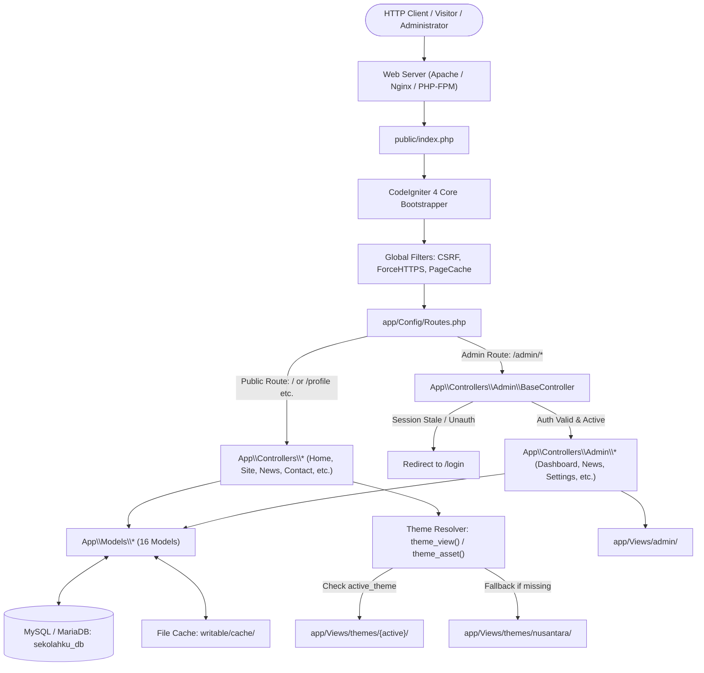
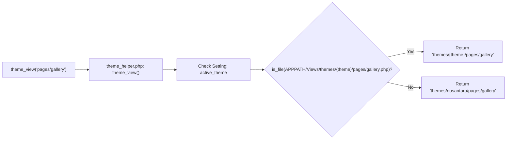

# CMS SekolahKu v3.2.0 — Architecture Analysis

> **Document Type:** Technical Architecture & System Flow Specification  
> **Target Version:** CMS SekolahKu v3.2.0  
> **Source Directory:** `c:\laragon\www\cms-sekolahku-v3.2.0-latest`  
> **Analysis Date:** 2026-11-12  

---

## 1. High-Level Architectural Pattern

CMS SekolahKu implements a decoupled **Model-View-Controller (MVC)** design pattern built on top of the **CodeIgniter 4** enterprise framework. The system architecture divides neatly into two operational spheres:

1. **Public Presentation Layer:** Decoupled multi-theme engine serving 13 core institutional pages, dynamic user-published pages, and AJAX endpoints.
2. **Administrative Management Layer:** Role-guarded control center powered by CoreUI 5, Quill rich-text editors, drag-and-drop sortable data tables, and batch management workflows.



---

## 2. Request-Response Lifecycle & Pipeline

### A. Public Request Execution Flow
1. **Entrypoint:** Request arrives at `public/index.php` with rewrite routing enabled via `public/.htaccess`.
2. **Filter Interception:** Global filters defined in `app/Config/Filters.php` execute before controller invocation:
   - `forcehttps` (if configured in `.env`).
   - `pagecache` checks `writable/cache/` for existing rendered output matching the URI (e.g., 5-minute cache on `/downloads` and `/contact`).
   - `csrf` validates tokens on incoming POST submissions.
3. **Controller Execution:**
   - The route maps to controllers such as `Home::index()`, `Site::profile()`, `News::detail()`, or `Contact::index()`.
   - Settings are retrieved in bulk via `SettingModel::getMany([...])` to minimize individual SQL queries.
   - Dynamic items are queried via model helpers: `ProgramModel::getOrdered()`, `TeacherModel::getOrdered()`, `EventModel::getUpcoming()`, `GalleryModel::getVisible()`.
4. **View Resolution via Theme Helper:**
   - Controllers invoke `view(theme_view('pages/home'), $data)`.
   - `theme_view()` checks the `active_theme` setting from the database (sanitized against alphanumeric characters to prevent directory traversal).
   - If `app/Views/themes/{theme}/{view}.php` exists, it renders that file. Otherwise, it falls back to `app/Views/themes/nusantara/{view}.php`.
5. **Asset Linking:**
   - CSS, JS, and image assets are resolved via `theme_asset('css/style.min.css')`, pointing to `public/themes/{theme}/...` with fallback to `public/themes/nusantara/...`.

### B. Administrative Request & Guard Flow
1. **Inheritance Guard:** Every admin controller (except `Admin\Auth`) extends `App\Controllers\Admin\BaseController`.
2. **Deep Session Re-Verification (`initController`):**
   ```php
   // app/Controllers/Admin/BaseController.php (Lines 32-51)
   if (!session()->get('isLoggedIn')) {
       session()->setFlashdata('error', 'Silakan login terlebih dahulu.');
       redirect()->to('/login')->send();
       exit;
   }
   
   $account = new UserModel()->select('id, role, is_active')->find((int)session()->get('userId'));
   if (!$account || (int)$account['is_active'] !== 1) {
       session()->remove(['isLoggedIn', 'userId', 'username', 'fullName', 'role']);
       redirect()->to('/login')->send();
       exit;
   }
   ```
   *Architectural Benefit:* If an administrator's account is disabled, deleted, or has its role revoked by a Superadmin, the active session is destroyed immediately on the user's very next click without waiting for session expiration.
3. **Superadmin RBAC Gate:**
   - Controllers handling high-privilege resources (specifically `Admin\Users`) enforce a secondary role check inside their own `initController()`:
     ```php
     if (($this->data['user']['role'] ?? '') !== 'superadmin') {
         redirect()->to('/admin/dashboard')->with('error', 'Akses ditolak.')->send();
         exit;
     }
     ```

---

## 3. Theme Engine & Multi-Tenant Frontend Architecture

The multi-theme system introduced in v3.2.0 decouples layout presentation from core business logic:

### A. Theme Directory Layout
```text
app/Views/themes/
├── cakrawala/         # Blue/Gold Modern Theme
│   ├── theme.json     # Metadata: title, description, version, author
│   ├── layouts/       # header.php, footer.php
│   └── pages/         # 13 standard subpages + home.php, single_post.php, page.php
├── lentera/           # Green/Nature Institutional Theme
│   ├── theme.json
│   ├── layouts/
│   └── pages/
└── nusantara/         # Canonical / Fallback Navy/Red Theme
    ├── theme.json
    ├── layouts/
    └── pages/
```

### B. Fallback Hierarchy & Asset Resolution


This architecture ensures that newly created custom themes need only override specific templates (e.g., only `header.php` or `home.php`) without duplicating the remaining 12 templates.

---

## 4. Navigation Architecture & Dynamic Hierarchy

### A. Navigation Menu Structure (`menu_items`)
The navigation system combines **built-in core routes** with **dynamic user-created menu items**:

1. **System Menus (`type = 'system'`):** Represent the 13 built-in routes (`profile`, `program`, `teachers`, `achievements`, etc.). They cannot be deleted from the database.
2. **Page Menus (`type = 'page'`):** Linked directly to static records in the `pages` table via foreign key `menu_items.page_id`. When a page is unpublished (`draft`), its menu item is automatically omitted from public navigation by `get_extra_nav_items()`.
3. **Custom Menus (`type = 'custom'`):** External URLs or internal relative links configured by the administrator.

### B. Recursive Cycle Detection (`hasCycle`)
In `app/Models/MenuItemModel.php`, cycle detection prevents catastrophic infinite loops when administrators reorder menus:
```php
public function hasCycle(array $parentMap): bool
{
    foreach ($parentMap as $id => $parentId) {
        $visited = [$id => true];
        $curr = $parentId;
        while ($curr !== null) {
            if (isset($visited[$curr])) {
                return true; // Cycle detected (A -> B -> C -> A)
            }
            $visited[$curr] = true;
            $curr = $parentMap[$curr] ?? null;
        }
    }
    return false;
}
```

### C. Public Menu Rendering & Limitations
- Desktop theme headers render 5 primary links: `Beranda`, `Profil`, `Program`, `Berita`, `Kontak`.
- A dedicated `Menu` button opens an accessible full-screen overlay index containing all 13 built-in pages plus all active dynamic menus (`get_extra_nav_items()`).
- **Architectural Constraint:** The themes do not currently contain CSS styles for nested desktop dropdown menus. As documented in `menu_helper.php` (Line 80), child items (`parent_id IS NOT NULL`) are omitted from public header rendering to prevent broken UI layouts.

---

## 5. Security Architecture & Threat Neutralization

CMS SekolahKu v3.2.0 incorporates comprehensive defensive controls across every layer:

### A. Anti-Brute-Force & Credential Stuffing Defense
Implemented in `Admin\Auth::attempt()` using CodeIgniter's rate-limiting `Throttler` service across two independent buckets:
- **Bucket 1 (IP Level):** Maximum 10 attempts per 60 seconds (`check('login-ip-' . $ip, 10, 60)`).
- **Bucket 2 (Account Level):** Maximum 5 failed attempts per 300 seconds (5 minutes) per normalized username key (`check('login-acct-' . md5($acctNorm), 5, 300)`).
- *Throttling Reset Behavior:* Legitimate successful logins reset the account bucket while retaining the IP bucket to safeguard against DDoS attacks.

### B. Dual-Layer Form Throttling
Both `Contact::send()` and `News::comment()` enforce two distinct protection rings:
1. **Session Throttling:** 1 submission every 30 seconds (`contact_last_sent`, `comment_last_sent`).
2. **IP Network Throttling:** 5 submissions per 10 minutes (`check('contact-ip-' . $ip, 5, 600)`), executed strictly after input validation passes so form validation errors do not consume the visitor's allowance.
3. **Honeypot Trap:** Hidden `website` input field. Submissions with filled honeypot fields are silently acknowledged as successful without performing database inserts.

### C. CSRF Token Synchronization Architecture
With CI4 configured for token regeneration on every POST (`Security::$regenerate = true`), dynamic AJAX interactions (in-place table edits, reordering, comment approvals) generate a new CSRF hash on every response.
- **Admin Layout (`app/Views/admin/layout.php`):** Defines `window.syncCsrf(hash)`, which automatically updates the `<meta name="csrf-token">` tag and all existing `<input name="csrf_test_name">` elements across the DOM.
- **Theme Scripts (`public/themes/*/js/script.js`):** Defines `syncCsrfToken()`, reading the fresh token directly from the browser's `csrf_cookie_name` cookie before submitting AJAX requests.

### D. File Upload Validation & Path Traversal Prevention
1. **Image Upload Pipeline (`Admin\News`, `Admin\Settings`, `Admin\Teachers`):**
   - File extensions are verified via `getimagesize()` against an allowlist: `IMAGETYPE_JPEG`, `IMAGETYPE_PNG`, `IMAGETYPE_WEBP`.
   - Dimension limits: Maximum 25 Megapixels to prevent GD memory exhaustion.
   - Storage naming: Filenames are generated using cryptographic random bytes (`time() . '_' . bin2hex(random_bytes(8)) . '.' . $ext`), ignoring the client-supplied filename.
2. **Upload Manager Deletion (`Admin\Uploads::delete`):**
   - Validates that the requested target path resides strictly inside `public/uploads/` using `realpath()` and `str_starts_with($filePath, $uploadsRoot . DIRECTORY_SEPARATOR)`.

---

## 6. Cache Layer & Performance Architecture

| Component | Mechanism | Invalidation Strategy |
| :--- | :--- | :--- |
| **Admin Dashboard Stats** | `cache()->remember('admin_dashboard_stats', 120)` | 120-second TTL covering 11 table count queries |
| **Admin Dashboard Feeds** | `cache()->remember('admin_dashboard_recent', 120)` | 120-second TTL covering 4 recent activity queries |
| **Public Downloads Page** | `Controller::cachePage(5)` | 5-minute HTTP response cache |
| **Public Contact Page** | `Controller::cachePage(5)` | 5-minute HTTP response cache |
| **Public News Listing** | `Controller::cachePage(1)` | 1-minute HTTP response cache (preserves `search`, `category`, `month` queries) |
| **Article Detail Page** | Dynamic (No cache) | Intentionally un-cached to support flash messages, CSRF tokens, and visitor comment feedback |
| **Theme Switching** | `cache()->clean()` | Invoked atomically when `active_theme` changes in Settings |

---

## 7. Complete Application Endpoints Routing Matrix

### A. Public Endpoints
| HTTP Method | URI Pattern | Target Controller & Method | Description |
| :--- | :--- | :--- | :--- |
| `GET` | `/` | `Home::index` | Homepage with hero, stats, news, agenda, programs, SPMB |
| `GET` | `/sitemap.xml` | `Sitemap::index` | Dynamic XML search engine sitemap |
| `GET` | `/profile` | `Site::profile` | School history, foundation, vision-mission, accreditation |
| `GET` | `/program` | `Site::program` | Academic concentrations & specialized learning tracks |
| `GET` | `/teachers` | `Site::teachers` | Faculty & staff credentials directory |
| `GET` | `/achievements` | `Site::achievements` | Student championship awards & medal records |
| `GET` | `/extracurriculars` | `Site::extracurriculars` | Student clubs & activities showcase |
| `GET` | `/testimonials` | `Site::testimonials` | Student, parent, and alumni testimonials |
| `GET` | `/gallery` | `Site::gallery` | Photo albums with category tabs & lightbox modal |
| `GET` | `/agenda` | `Site::agenda` | Academic calendar & upcoming school events |
| `GET` | `/faq` | `Site::faq` | Frequently Asked Questions accordion |
| `GET` | `/news` | `News::index` | Articles with search, category & monthly archive filters |
| `GET` | `/news/search` | `News::search` | AJAX live search endpoint (returns JSON) |
| `GET` | `/news/(:any)` | `News::detail/$1` | Single article view with comments & related articles |
| `POST` | `/news/(:any)/comment`| `News::comment/$1` | Submit article comment (throttled, unapproved) |
| `GET` | `/downloads` | `Downloads::index` | Download center with instant keyword search |
| `GET` | `/contact` | `Contact::index` | Contact details, office hours, and message form |
| `POST` | `/contact/send` | `Contact::send` | Submit contact message (AJAX / redirect, throttled) |
| `GET` | `/login` | `Admin\Auth::login` | Administrator authentication login screen |
| `POST` | `/login/attempt` | `Admin\Auth::attempt` | Process login submission (dual-rate limited) |
| `POST` | `/logout` | `Admin\Auth::logout` | Terminate session & redirect to login |
| `GET` | `/(:any)` | `Pages::view/$1` | Dynamic static page catch-all (lowest priority) |

### B. Administrative Endpoints
| HTTP Method | URI Pattern | Controller Action | Role Level |
| :--- | :--- | :--- | :--- |
| `GET` | `/admin` / `/admin/dashboard` | `Admin\Dashboard::index` | Editor+ |
| `GET`/`POST` | `/admin/settings` / `save` | `Admin\Settings::index` / `save` | Editor+ |
| `CRUD` | `/admin/news` | `Admin\News` (Presenter: index, new, create, edit, update, delete) | Editor+ |
| `POST` | `/admin/news/quick-update/(:num)` | `Admin\News::quickUpdate/$1` (AJAX In-place) | Editor+ |
| `CRUD` | `/admin/teachers` | `Admin\Teachers` | Editor+ |
| `POST` | `/admin/teachers/reorder` | `Admin\Teachers::reorder` (AJAX Drag-and-drop) | Editor+ |
| `CRUD` | `/admin/programs` | `Admin\Programs` | Editor+ |
| `POST` | `/admin/programs/reorder` | `Admin\Programs::reorder` (AJAX Drag-and-drop) | Editor+ |
| `CRUD` | `/admin/extracurriculars` | `Admin\Extracurriculars` | Editor+ |
| `POST` | `/admin/extracurriculars/reorder` | `Admin\Extracurriculars::reorder` | Editor+ |
| `CRUD` | `/admin/achievements` | `Admin\Achievements` | Editor+ |
| `POST` | `/admin/achievements/reorder` | `Admin\Achievements::reorder` | Editor+ |
| `CRUD` | `/admin/testimonials` | `Admin\Testimonials` | Editor+ |
| `POST` | `/admin/testimonials/reorder` | `Admin\Testimonials::reorder` | Editor+ |
| `CRUD` | `/admin/events` | `Admin\Events` | Editor+ |
| `CRUD` | `/admin/gallery` | `Admin\Galleries` | Editor+ |
| `POST` | `/admin/gallery/reorder` | `Admin\Galleries::reorder` | Editor+ |
| `CRUD` | `/admin/faq` | `Admin\Faq` | Editor+ |
| `POST` | `/admin/faq/reorder` | `Admin\Faq::reorder` | Editor+ |
| `CRUD` | `/admin/downloads` | `Admin\Downloads` | Editor+ |
| `POST` | `/admin/downloads/reorder` | `Admin\Downloads::reorder` | Editor+ |
| `CRUD` | `/admin/pages` | `Admin\Pages` | Editor+ |
| `CRUD` | `/admin/menus` | `Admin\Menus` | Editor+ |
| `POST` | `/admin/menus/reorder` | `Admin\Menus::reorder` (Cycle-checked) | Editor+ |
| `GET` | `/admin/messages` | `Admin\Messages::index` (Filter: all, unread, read) | Editor+ |
| `GET`/`POST` | `/admin/messages/(:num)` | `Admin\Messages::show` / `markRead` / `markUnread` / `delete` | Editor+ |
| `POST` | `/admin/messages/bulk-delete` | `Admin\Messages::bulkDelete` | Editor+ |
| `GET` | `/admin/comments` | `Admin\Comments::index` (Filter: all, pending, approved) | Editor+ |
| `POST` | `/admin/comments/approve/(:num)` | `Admin\Comments::approve/$1` | Editor+ |
| `POST` | `/admin/comments/reject/(:num)` | `Admin\Comments::reject/$1` (Delete unapproved) | Editor+ |
| `POST` | `/admin/comments/bulk` | `Admin\Comments::bulk` (Approve/Delete batch) | Editor+ |
| `GET`/`POST` | `/admin/uploads` / `delete` | `Admin\Uploads::index` / `delete` | Editor+ |
| `GET`/`POST` | `/admin/profile` / `save` | `Admin\Profile::index` / `update` | Editor+ |
| `CRUD` | `/admin/users` | `Admin\Users` | **Superadmin Only** |
