# CMS SekolahKu v3.2.0 — Database Architecture & Analysis

> **Document Type:** Database Schema, Relationships & Migration Analysis  
> **Target Version:** CMS SekolahKu v3.2.0  
> **Source Files:** `sekolahku_db.sql`, `UPGRADE.sql`, `app/Database/Migrations/`, `app/Models/`  
> **Analysis Date:** 2026-11-12  

---

## 1. Database Architecture Overview

CMS SekolahKu operates on a relational **MySQL / MariaDB** database using the **InnoDB** storage engine with the `utf8mb4_general_ci` character set, providing full multibyte Unicode support (including Indonesian accents, mathematical symbols, and emojis).

### Core Database Metrics
- **Total Tables:** 16 Tables
- **Storage Engine:** InnoDB (ACID compliant with row-level locking)
- **Character Set / Collation:** `utf8mb4` / `utf8mb4_general_ci`
- **Primary Key Strategy:** Auto-incrementing unsigned integers (`INT UNSIGNED NOT NULL AUTO_INCREMENT`)
- **Timestamp Strategy:** Automated `created_at` (`DEFAULT CURRENT_TIMESTAMP`) and `updated_at` (`DEFAULT CURRENT_TIMESTAMP ON UPDATE CURRENT_TIMESTAMP`) on 15 of 16 tables.

---

## 2. Entity-Relationship (ER) Diagram

```mermaid
erDiagram
    USERS {
        int id PK
        varchar username UK
        varchar email UK
        varchar password
        varchar full_name
        varchar avatar
        enum role
        tinyint is_active
        datetime last_login
        datetime created_at
        datetime updated_at
    }

    PAGES {
        int id PK
        varchar title
        varchar slug UK
        longtext content
        text excerpt
        varchar image
        enum status
        varchar meta_title
        varchar meta_description
        datetime created_at
        datetime updated_at
    }

    MENU_ITEMS {
        int id PK
        int parent_id FK
        varchar title
        varchar url
        enum target
        varchar icon
        varchar section_key
        int sort_order
        tinyint status
        varchar type
        int page_id FK
        datetime created_at
        datetime updated_at
    }

    NEWS {
        int id PK
        varchar category
        json tags
        varchar title
        varchar slug UK
        text excerpt
        longtext content
        varchar image
        varchar author
        datetime published_at
        enum status
        tinyint is_featured
        varchar meta_title
        varchar meta_description
        int view_count
        datetime created_at
        datetime updated_at
    }

    NEWS_COMMENTS {
        int id PK
        int news_id FK
        int parent_id FK
        varchar name
        varchar email
        varchar avatar
        text comment
        tinyint is_approved
        datetime created_at
        datetime updated_at
    }

    CONTACT_MESSAGES {
        int id PK
        varchar name
        varchar email
        varchar subject
        text message
        tinyint is_read
        datetime created_at
        datetime updated_at
    }

    EVENTS {
        int id PK
        varchar title
        varchar slug UK
        text description
        varchar location
        date event_date
        varchar event_time
        tinyint sort_order
        enum status
        tinyint show
        datetime created_at
        datetime updated_at
    }

    DOWNLOADS {
        int id PK
        varchar category
        varchar title
        text description
        varchar url
        varchar file_size
        int sort_order
        tinyint show
        datetime created_at
        datetime updated_at
    }

    ACHIEVEMENTS {
        int id PK
        varchar student_name
        varchar photo
        varchar class_name
        varchar achievement
        varchar level
        year year
        enum medal
        tinyint sort_order
        tinyint show
        datetime created_at
        datetime updated_at
    }

    TEACHERS {
        int id PK
        varchar name
        varchar photo
        varchar role
        varchar experience
        varchar education
        varchar social_facebook
        varchar social_instagram
        varchar social_linkedin
        tinyint sort_order
        tinyint show
        datetime created_at
        datetime updated_at
    }

    PROGRAMS {
        int id PK
        varchar title
        text description
        varchar icon
        varchar link_url
        varchar link_text
        tinyint sort_order
        tinyint show
        datetime created_at
        datetime updated_at
    }

    EXTRACURRICULARS {
        int id PK
        varchar title
        text description
        varchar icon
        varchar icon_color
        tinyint sort_order
        tinyint show
        datetime created_at
        datetime updated_at
    }

    GALLERIES {
        int id PK
        varchar category
        varchar image
        varchar caption
        tinyint is_featured
        tinyint sort_order
        tinyint show
        datetime created_at
        datetime updated_at
    }

    FAQ {
        int id PK
        varchar question
        text answer
        varchar category
        tinyint sort_order
        tinyint show
        datetime created_at
        datetime updated_at
    }

    TESTIMONIALS {
        int id PK
        varchar name
        varchar photo
        varchar role
        text quote
        tinyint sort_order
        tinyint show
        datetime created_at
        datetime updated_at
    }

    SETTINGS {
        int id PK
        varchar key UK
        text value
        datetime created_at
        datetime updated_at
    }

    PAGES ||--o{ MENU_ITEMS : "attached to (ON DELETE SET NULL)"
    MENU_ITEMS ||--o{ MENU_ITEMS : "parent-child hierarchy (ON DELETE CASCADE)"
    NEWS ||--o{ NEWS_COMMENTS : "receives (ON DELETE CASCADE)"
    NEWS_COMMENTS ||--o{ NEWS_COMMENTS : "replies to (ON DELETE CASCADE)"
```



---

## 3. Comprehensive Table Schema Specifications

### 1. `users` — Administrator & Staff Credentials
Stores administrative accounts, password hashes, and access tiers.
```sql
CREATE TABLE `users` (
  `id` int unsigned NOT NULL AUTO_INCREMENT,
  `username` varchar(100) NOT NULL,
  `email` varchar(200) NOT NULL,
  `password` varchar(255) NOT NULL,
  `full_name` varchar(200) DEFAULT NULL,
  `avatar` varchar(255) DEFAULT NULL,
  `role` enum('superadmin','admin','editor') NOT NULL DEFAULT 'editor',
  `is_active` tinyint(1) DEFAULT '1',
  `last_login` datetime DEFAULT NULL,
  `created_at` datetime DEFAULT CURRENT_TIMESTAMP,
  `updated_at` datetime DEFAULT CURRENT_TIMESTAMP ON UPDATE CURRENT_TIMESTAMP,
  PRIMARY KEY (`id`),
  UNIQUE KEY `username` (`username`),
  UNIQUE KEY `email` (`email`)
) ENGINE=InnoDB DEFAULT CHARSET=utf8mb4;
```

### 2. `settings` — System Configuration & Dynamic Parameters
Atomic key-value store for branding, contacts, social media, JSON arrays, and themes.
```sql
CREATE TABLE `settings` (
  `id` int unsigned NOT NULL AUTO_INCREMENT,
  `key` varchar(100) NOT NULL,
  `value` text,
  `created_at` datetime DEFAULT CURRENT_TIMESTAMP,
  `updated_at` datetime DEFAULT CURRENT_TIMESTAMP ON UPDATE CURRENT_TIMESTAMP,
  PRIMARY KEY (`id`),
  UNIQUE KEY `key` (`key`)
) ENGINE=InnoDB DEFAULT CHARSET=utf8mb4;
```
*Key Record Groups:*
- Site Identity: `site_name`, `site_tagline`, `site_description`, `site_logo_text`, `site_logo_icon`, `site_url`.
- Contact Info: `contact_phone`, `contact_email`, `contact_address`, `contact_hours`.
- Social Media: `social_facebook`, `social_instagram`, `social_youtube`, `social_tiktok`.
- Hero Section: `hero_badge`, `hero_title`, `hero_subtitle`, `hero_btn_primary_text`, `hero_btn_primary_url`, `hero_btn_secondary_text`, `hero_btn_secondary_url`, `spmb_url`.
- Complex JSON structures: `counter_stats`, `hero_stats`, `principal`, `about`, `page_banners`, `footer_services`, `footer_links`, `spmb_steps`.
- Theme State: `active_theme` (e.g. `'nusantara'`).

### 3. `news` — Articles, News & Announcements
```sql
CREATE TABLE `news` (
  `id` int unsigned NOT NULL AUTO_INCREMENT,
  `category` varchar(100) DEFAULT NULL,
  `tags` json DEFAULT NULL,
  `title` varchar(255) NOT NULL,
  `slug` varchar(255) NOT NULL,
  `excerpt` text,
  `content` longtext,
  `image` varchar(255) DEFAULT NULL,
  `author` varchar(100) DEFAULT 'Admin',
  `published_at` datetime DEFAULT NULL,
  `status` enum('draft','published','archived') DEFAULT 'draft',
  `is_featured` tinyint(1) DEFAULT '0',
  `meta_title` varchar(255) DEFAULT NULL,
  `meta_description` varchar(255) DEFAULT NULL,
  `view_count` int unsigned DEFAULT '0',
  `created_at` datetime DEFAULT CURRENT_TIMESTAMP,
  `updated_at` datetime DEFAULT CURRENT_TIMESTAMP ON UPDATE CURRENT_TIMESTAMP,
  PRIMARY KEY (`id`),
  UNIQUE KEY `slug` (`slug`),
  KEY `idx_news_status` (`status`),
  KEY `idx_news_published` (`published_at`)
) ENGINE=InnoDB DEFAULT CHARSET=utf8mb4;
```

### 4. `news_comments` — Reader Discussions & Moderation
```sql
CREATE TABLE `news_comments` (
  `id` int unsigned NOT NULL AUTO_INCREMENT,
  `news_id` int unsigned NOT NULL,
  `parent_id` int unsigned DEFAULT NULL,
  `name` varchar(200) NOT NULL,
  `email` varchar(200) DEFAULT NULL,
  `avatar` varchar(255) DEFAULT NULL,
  `comment` text NOT NULL,
  `is_approved` tinyint(1) DEFAULT '0',
  `created_at` datetime DEFAULT CURRENT_TIMESTAMP,
  `updated_at` datetime DEFAULT CURRENT_TIMESTAMP ON UPDATE CURRENT_TIMESTAMP,
  PRIMARY KEY (`id`),
  KEY `news_id` (`news_id`),
  KEY `parent_id` (`parent_id`),
  KEY `idx_comments_approved` (`is_approved`),
  KEY `idx_comments_created` (`created_at`,`id`),
  CONSTRAINT `news_comments_ibfk_1` FOREIGN KEY (`news_id`) REFERENCES `news` (`id`) ON DELETE CASCADE,
  CONSTRAINT `news_comments_ibfk_2` FOREIGN KEY (`parent_id`) REFERENCES `news_comments` (`id`) ON DELETE CASCADE
) ENGINE=InnoDB DEFAULT CHARSET=utf8mb4;
```

### 5. `pages` — User-Created Custom Static Pages
```sql
CREATE TABLE `pages` (
  `id` int unsigned NOT NULL AUTO_INCREMENT,
  `title` varchar(255) NOT NULL,
  `slug` varchar(255) NOT NULL,
  `content` longtext,
  `excerpt` text,
  `image` varchar(255) DEFAULT NULL,
  `status` enum('draft','published') DEFAULT 'draft',
  `meta_title` varchar(255) DEFAULT NULL,
  `meta_description` varchar(255) DEFAULT NULL,
  `created_at` datetime DEFAULT CURRENT_TIMESTAMP,
  `updated_at` datetime DEFAULT CURRENT_TIMESTAMP ON UPDATE CURRENT_TIMESTAMP,
  PRIMARY KEY (`id`),
  UNIQUE KEY `slug` (`slug`)
) ENGINE=InnoDB DEFAULT CHARSET=utf8mb4;
```

### 6. `menu_items` — Navigation Tree Hierarchy
```sql
CREATE TABLE `menu_items` (
  `id` int unsigned NOT NULL AUTO_INCREMENT,
  `parent_id` int unsigned DEFAULT NULL,
  `title` varchar(200) NOT NULL,
  `url` varchar(255) NOT NULL,
  `target` enum('_self','_blank') DEFAULT '_self',
  `icon` varchar(50) DEFAULT NULL,
  `section_key` varchar(100) DEFAULT NULL,
  `sort_order` int unsigned DEFAULT '0',
  `status` tinyint(1) DEFAULT '1',
  `type` varchar(20) DEFAULT 'custom',
  `page_id` int unsigned DEFAULT NULL,
  `created_at` datetime DEFAULT CURRENT_TIMESTAMP,
  `updated_at` datetime DEFAULT CURRENT_TIMESTAMP ON UPDATE CURRENT_TIMESTAMP,
  PRIMARY KEY (`id`),
  KEY `parent_id` (`parent_id`),
  KEY `page_id` (`page_id`),
  CONSTRAINT `menu_items_ibfk_1` FOREIGN KEY (`parent_id`) REFERENCES `menu_items` (`id`) ON DELETE CASCADE,
  CONSTRAINT `menu_items_ibfk_2` FOREIGN KEY (`page_id`) REFERENCES `pages` (`id`) ON DELETE SET NULL
) ENGINE=InnoDB DEFAULT CHARSET=utf8mb4;
```

### 7. `events` — School Event Calendar & Agenda
```sql
CREATE TABLE `events` (
  `id` int unsigned NOT NULL AUTO_INCREMENT,
  `title` varchar(255) NOT NULL,
  `slug` varchar(255) NOT NULL,
  `description` text,
  `location` varchar(255) DEFAULT NULL,
  `event_date` date NOT NULL,
  `event_time` varchar(50) DEFAULT NULL,
  `sort_order` tinyint unsigned DEFAULT '0',
  `status` enum('upcoming','ongoing','completed','cancelled') DEFAULT 'upcoming',
  `show` tinyint(1) DEFAULT '1',
  `created_at` datetime DEFAULT CURRENT_TIMESTAMP,
  `updated_at` datetime DEFAULT CURRENT_TIMESTAMP ON UPDATE CURRENT_TIMESTAMP,
  PRIMARY KEY (`id`),
  UNIQUE KEY `slug` (`slug`),
  KEY `idx_events_date` (`event_date`),
  KEY `idx_events_status` (`status`)
) ENGINE=InnoDB DEFAULT CHARSET=utf8mb4;
```

### 8. `downloads` — Academic Repository & Official Forms
```sql
CREATE TABLE `downloads` (
  `id` int unsigned NOT NULL AUTO_INCREMENT,
  `category` varchar(100) NOT NULL,
  `title` varchar(255) NOT NULL,
  `description` text,
  `url` varchar(500) NOT NULL,
  `file_size` varchar(50) DEFAULT NULL,
  `sort_order` int unsigned DEFAULT '0',
  `show` tinyint(1) DEFAULT '1',
  `created_at` datetime DEFAULT CURRENT_TIMESTAMP,
  `updated_at` datetime DEFAULT CURRENT_TIMESTAMP ON UPDATE CURRENT_TIMESTAMP,
  PRIMARY KEY (`id`),
  KEY `idx_downloads_category` (`category`),
  KEY `idx_downloads_sort_order` (`sort_order`)
) ENGINE=InnoDB DEFAULT CHARSET=utf8mb4;
```

### 9. `achievements` — Student Awards & Competitions
```sql
CREATE TABLE `achievements` (
  `id` int unsigned NOT NULL AUTO_INCREMENT,
  `student_name` varchar(200) NOT NULL,
  `photo` varchar(255) DEFAULT NULL,
  `class_name` varchar(100) DEFAULT NULL,
  `achievement` varchar(255) NOT NULL,
  `level` varchar(50) DEFAULT NULL,
  `year` year DEFAULT NULL,
  `medal` enum('gold','silver','bronze') DEFAULT 'gold',
  `sort_order` tinyint unsigned DEFAULT '0',
  `show` tinyint(1) DEFAULT '1',
  `created_at` datetime DEFAULT CURRENT_TIMESTAMP,
  `updated_at` datetime DEFAULT CURRENT_TIMESTAMP ON UPDATE CURRENT_TIMESTAMP,
  PRIMARY KEY (`id`)
) ENGINE=InnoDB DEFAULT CHARSET=utf8mb4;
```

### 10. `teachers` — Faculty & Staff Directory
```sql
CREATE TABLE `teachers` (
  `id` int unsigned NOT NULL AUTO_INCREMENT,
  `name` varchar(200) NOT NULL,
  `photo` varchar(255) DEFAULT NULL,
  `role` varchar(200) DEFAULT NULL,
  `experience` varchar(100) DEFAULT NULL,
  `education` varchar(100) DEFAULT NULL,
  `social_facebook` varchar(255) DEFAULT NULL,
  `social_instagram` varchar(255) DEFAULT NULL,
  `social_linkedin` varchar(255) DEFAULT NULL,
  `sort_order` tinyint unsigned DEFAULT '0',
  `show` tinyint(1) DEFAULT '1',
  `created_at` datetime DEFAULT CURRENT_TIMESTAMP,
  `updated_at` datetime DEFAULT CURRENT_TIMESTAMP ON UPDATE CURRENT_TIMESTAMP,
  PRIMARY KEY (`id`)
) ENGINE=InnoDB DEFAULT CHARSET=utf8mb4;
```

### 11. `programs` — Educational Concentrations & Majors
```sql
CREATE TABLE `programs` (
  `id` int unsigned NOT NULL AUTO_INCREMENT,
  `title` varchar(200) NOT NULL,
  `description` text,
  `icon` varchar(50) DEFAULT 'star',
  `link_url` varchar(255) DEFAULT NULL,
  `link_text` varchar(100) DEFAULT 'Selengkapnya',
  `sort_order` tinyint unsigned DEFAULT '0',
  `show` tinyint(1) DEFAULT '1',
  `created_at` datetime DEFAULT CURRENT_TIMESTAMP,
  `updated_at` datetime DEFAULT CURRENT_TIMESTAMP ON UPDATE CURRENT_TIMESTAMP,
  PRIMARY KEY (`id`)
) ENGINE=InnoDB DEFAULT CHARSET=utf8mb4;
```

### 12. `extracurriculars` — Student Clubs & Organizations
```sql
CREATE TABLE `extracurriculars` (
  `id` int unsigned NOT NULL AUTO_INCREMENT,
  `title` varchar(200) NOT NULL,
  `description` text,
  `icon` varchar(50) DEFAULT 'star',
  `icon_color` varchar(7) DEFAULT '#14b8a6',
  `sort_order` tinyint unsigned DEFAULT '0',
  `show` tinyint(1) DEFAULT '1',
  `created_at` datetime DEFAULT CURRENT_TIMESTAMP,
  `updated_at` datetime DEFAULT CURRENT_TIMESTAMP ON UPDATE CURRENT_TIMESTAMP,
  PRIMARY KEY (`id`)
) ENGINE=InnoDB DEFAULT CHARSET=utf8mb4;
```

### 13. `galleries` — Photo Albums & Activity Archives
```sql
CREATE TABLE `galleries` (
  `id` int unsigned NOT NULL AUTO_INCREMENT,
  `category` varchar(100) DEFAULT NULL,
  `image` varchar(255) NOT NULL,
  `caption` varchar(255) DEFAULT NULL,
  `is_featured` tinyint(1) DEFAULT '0',
  `sort_order` tinyint unsigned DEFAULT '0',
  `show` tinyint(1) DEFAULT '1',
  `created_at` datetime DEFAULT CURRENT_TIMESTAMP,
  `updated_at` datetime DEFAULT CURRENT_TIMESTAMP ON UPDATE CURRENT_TIMESTAMP,
  PRIMARY KEY (`id`)
) ENGINE=InnoDB DEFAULT CHARSET=utf8mb4;
```

### 14. `faq` — Frequently Asked Questions
```sql
CREATE TABLE `faq` (
  `id` int unsigned NOT NULL AUTO_INCREMENT,
  `question` varchar(255) NOT NULL,
  `answer` text NOT NULL,
  `category` varchar(100) DEFAULT NULL,
  `sort_order` tinyint unsigned DEFAULT '0',
  `show` tinyint(1) DEFAULT '1',
  `created_at` datetime DEFAULT CURRENT_TIMESTAMP,
  `updated_at` datetime DEFAULT CURRENT_TIMESTAMP ON UPDATE CURRENT_TIMESTAMP,
  PRIMARY KEY (`id`)
) ENGINE=InnoDB DEFAULT CHARSET=utf8mb4;
```

### 15. `testimonials` — Stakeholder Quotes
```sql
CREATE TABLE `testimonials` (
  `id` int unsigned NOT NULL AUTO_INCREMENT,
  `name` varchar(200) NOT NULL,
  `photo` varchar(255) DEFAULT NULL,
  `role` varchar(200) DEFAULT NULL,
  `quote` text NOT NULL,
  `sort_order` tinyint unsigned DEFAULT '0',
  `show` tinyint(1) DEFAULT '1',
  `created_at` datetime DEFAULT CURRENT_TIMESTAMP,
  `updated_at` datetime DEFAULT CURRENT_TIMESTAMP ON UPDATE CURRENT_TIMESTAMP,
  PRIMARY KEY (`id`)
) ENGINE=InnoDB DEFAULT CHARSET=utf8mb4;
```

### 16. `contact_messages` — Visitor Inquiries Inbox
```sql
CREATE TABLE `contact_messages` (
  `id` int unsigned NOT NULL AUTO_INCREMENT,
  `name` varchar(200) NOT NULL,
  `email` varchar(200) NOT NULL,
  `subject` varchar(255) DEFAULT NULL,
  `message` text NOT NULL,
  `is_read` tinyint(1) DEFAULT '0',
  `created_at` datetime DEFAULT CURRENT_TIMESTAMP,
  `updated_at` datetime DEFAULT CURRENT_TIMESTAMP ON UPDATE CURRENT_TIMESTAMP,
  PRIMARY KEY (`id`),
  KEY `idx_messages_read` (`is_read`),
  KEY `idx_messages_created` (`created_at`,`id`)
) ENGINE=InnoDB DEFAULT CHARSET=utf8mb4;
```

---

## 4. Key Relational Integrity & Cascading Rules

1. **`menu_items.parent_id -> menu_items.id` (`ON DELETE CASCADE`):**  
   Deleting a parent menu item automatically removes all nested child menu items.
2. **`menu_items.page_id -> pages.id` (`ON DELETE SET NULL`):**  
   Deleting a static page retains the menu entry in `menu_items`, but disassociates the page binding (`page_id` becomes `NULL`), preventing orphaned foreign key exceptions (`HTTP 500`).
3. **`news_comments.news_id -> news.id` (`ON DELETE CASCADE`):**  
   Deleting a news article automatically purges all associated reader comments.
4. **`news_comments.parent_id -> news_comments.id` (`ON DELETE CASCADE`):**  
   Deleting a top-level comment cascades to delete all nested reply comments.

---

## 5. Indexing & Query Optimization Analysis

- **Composite Ordering Index on `contact_messages(created_at, id)`:**  
  Eliminates `Using filesort` on admin pagination queries (`ORDER BY created_at DESC, id DESC`).
- **Composite Ordering Index on `news_comments(created_at, id)`:**  
  Optimizes paginated moderation queue scans.
- **Index on `events(event_date)` & `events(status)`:**  
  Accelerates date-range queries executed by `EventModel::getUpcoming()`.
- **Index on `downloads(category)` & `downloads(sort_order)`:**  
  Optimizes categorized grouped listings in the download center.
- **Unique Indexes on Slugs:** Enforces unique URI lookups for `news(slug)`, `pages(slug)`, and `events(slug)`.
