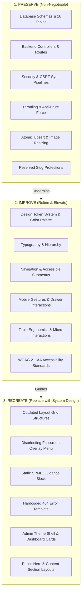

# CMS SekolahKu v3.2.0 — Recreation Readiness & Preparation Guide

> **Document Type:** System Design Integration & Recreation Readiness Plan  
> **Target Version:** CMS SekolahKu v3.2.0  
> **Source Directory:** `c:\laragon\www\cms-sekolahku-v3.2.0-latest`  
> **Analysis Date:** 2026-11-12  

---

## 1. Readiness Mandate

Before integrating the upcoming **System Design** specification in the next prompt, this document establishes clear, unambiguous boundaries governing what must be **PRESERVED**, what should be **IMPROVED**, and what must be **RECREATED**.

Treat existing working backend business logic and database structures as the primary source of truth.

---

## 2. Categorization Framework

---

## 3. Detailed Boundary Definitions

### A. PRESERVE (Must NOT Be Broken or Modified)
1. **Database Schema & Relational Integrity:**
   - Retain all 16 table structures (`users`, `settings`, `news`, `news_comments`, `pages`, `menu_items`, `events`, `downloads`, `achievements`, `teachers`, `programs`, `extracurriculars`, `galleries`, `faq`, `testimonials`, `contact_messages`).
   - Retain all column names, default values, foreign key cascades (`menu_items`, `news_comments`), and composite indexes (`idx_messages_created`, `idx_comments_created`).
2. **Backend Application Contracts & Routes:**
   - All public endpoints (`/`, `/profile`, `/program`, `/teachers`, `/achievements`, `/extracurriculars`, `/testimonials`, `/gallery`, `/agenda`, `/faq`, `/news`, `/downloads`, `/contact`, `/sitemap.xml`) must remain active.
   - All admin presenter endpoints (`/admin/news`, `/admin/teachers`, etc.) and AJAX reorder routes (`/admin/{resource}/reorder`) must be preserved.
3. **Authentication & Session Security:**
   - The deep account re-verification inside `Admin\BaseController::initController()` must stay intact.
   - Dual-bucket rate limiting for authentication (`Admin\Auth::attempt()`) and IP throttles on forms must remain active.
4. **CSRF Protection & Token Synchronization:**
   - Retain `window.syncCsrf()` and `syncCsrfToken()` protocols to prevent 403 Forbidden errors across AJAX actions.
5. **URL Security & Sanitization:**
   - Retain `is_safe_link_url()` and `is_dangerous_url()` helpers to block malicious schemes (`javascript:`, `data:`, `vbscript:`).
6. **Unique Slug Safeguards:**
   - Preserve `PageModel::$reservedSlugs` collision prevention.

---

### B. IMPROVE (Refine, Modernize & Enhance)
1. **Design System & Visual Tokens:**
   - Modernize color token variables, elevation layers, and semantic surfaces.
   - Unify font scales, line heights, and letter spacing across display, headings, body, and monospace elements.
2. **Navigation & Information Architecture:**
   - Expand the navigation engine to support **dropdown submenus** for child menu items (`parent_id IS NOT NULL`), resolving the current limitation where child menus are dropped on the frontend.
   - Introduce structured breadcrumbs on all subpages (`/profile`, `/news/(:any)`, etc.) to improve wayfinding and SEO.
3. **Form Experience & Micro-Interactions:**
   - Enhance forms with real-time client-side validation feedback, loading spinners, and clear error banners.
   - Improve Quill editor styling to accurately reflect frontend typography.
4. **Data Tables & Admin Interactions:**
   - Modernize `.table-crud` styling with sleek borders, sticky action toolbars, and smoother drag-and-drop animations.
5. **Accessibility (WCAG 2.1 AA):**
   - Ensure color contrast ratios meet or exceed 4.5:1 for normal text and 3:1 for large display text.
   - Standardize `aria-expanded`, `aria-controls`, and keyboard focus rings across all interactive widgets.

---

### C. RECREATE (Completely Rebuild to Meet Upcoming System Design)
1. **Public Theme Layouts:**
   - Recreate `layouts/header.php`, `layouts/footer.php`, and `pages/home.php` to align with the new System Design specification.
   - Replace the intrusive fullscreen desktop overlay (`#menuOverlay`) with a modern, elegant mega-menu or multi-tier navigation bar.
2. **Admissions (SPMB) Experience:**
   - Transform the static 10-step list into an engaging, interactive admissions journey component featuring interactive tab steps, document checklists, and downloadable forms.
3. **Theme Error Pages:**
   - Recreate `app/Views/errors/html/error_404.php` to dynamically inherit the colors and styles of the currently active theme, eliminating hardcoded palettes.
4. **Admin Dashboard Visuals:**
   - Redesign `/admin/dashboard` to incorporate modern statistics cards, status indicators, and clean layout distribution.

---

## 4. Pre-Flight Checklist for System Design Integration

- [x] Full codebase scan completed across all files and directories.
- [x] All 16 database tables and relationships fully mapped.
- [x] Security mechanics (CSRF, throttling, XSS guards) documented.
- [x] Theme resolution mechanics and fallback logic analyzed.
- [x] Technical risks and architectural limitations indexed.
- [x] No existing application source code modified during discovery.
- [x] Project intelligence documentation compiled in `docs/project-intelligence/`.
- [x] Ready to receive and implement the new System Design specification.
